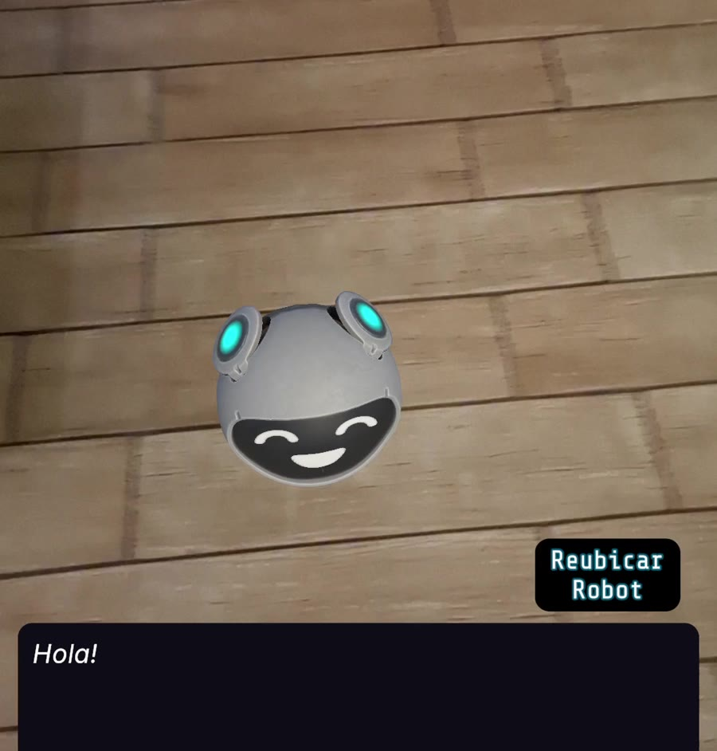
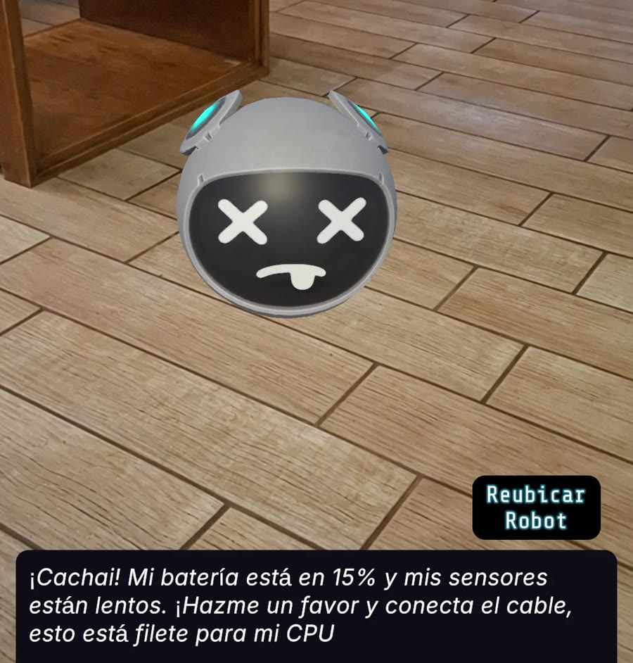

# RoboPet: mascota virtual con LLM local y realidad aumentada

Prototipo Android de una mascota robot en realidad aumentada. La mascota tiene necesidades que cambian con el tiempo (energía, felicidad y mantenimiento), responde a cuidados, incluye un minijuego en AR y conversa mediante un modelo de lenguaje que se ejecuta **en el propio teléfono**, sin servidor.

Proyecto de la asignatura Tecnologías Emergentes, Pontificia Universidad Católica de Valparaíso (2026).

▶️ **[Video de demostración (2 min)](https://drive.google.com/file/d/1UGqRIpf6AXL4GpizPfEnIeX_I8KjWRhB/view?usp=sharing)**

| Colocación en AR | Respuesta según el estado |
|---|---|
|  |  |
| La mascota aparece donde el usuario toca el suelo detectado. | Con batería crítica, el modelo responde según el estado que el código agrega como contexto. |

## Características

- Colocación de la mascota sobre planos detectados con AR Foundation / ARCore.
- Máquina de estados (FSM) con necesidades que decaen con el tiempo y acciones de cuidado (recargar, mantenimiento, jugar).
- Chat con un modelo **Qwen3.5 0.8B (GGUF, Q4_K_M)** ajustado con fine-tuning para la personalidad del robot y ejecutado localmente con LLMUnity.
- Minijuego en AR para atrapar al robot.

## Cómo funciona el chat

1. `RobotStateManager.cs` calcula el estado del robot a partir de sus necesidades:

   | Estado | Condición |
   |---|---|
   | `BateriaCritica` | Energía ≤ 30 |
   | `Descalibrado` | Mantenimiento ≤ 30 |
   | `Aburrido` | Felicidad ≤ 30 |
   | `Euforico` | Felicidad ≥ 80 |
   | `Normal` | Por defecto |

2. En cada mensaje y en cada evento del juego, el código agrega al prompt una instrucción de sistema con el estado actual (`CrearContexto()`).
3. El modelo ajustado responde con la personalidad de "Rob", un robot sarcástico con modismos chilenos, de acuerdo con ese estado.

## Modelo y dataset (`AI_FineTuning/`)

```
Prompts + API de Gemini → 1.000 conversaciones sintéticas (ChatML/JSONL)
→ validación y partición 850 / 100 / 50 (semilla fija)
→ fine-tuning de Qwen3.5 0.8B con Unsloth → exportación GGUF (Q4_K_M)
→ LLMUnity en Android
```

- El dataset se diseñó como una matriz de 5 estados × 10 eventos del juego × 20 ejemplos.
- `generador_dataset.py` genera las conversaciones, retoma el progreso si se interrumpe, escribe de forma incremental y reintenta ante errores de la API.
- `procesar_dataset.py` valida la estructura de cada fila, mezcla y divide los datos.
- Detalle completo en [`AI_FineTuning/DOCUMENTACION_DATASET.md`](AI_FineTuning/DOCUMENTACION_DATASET.md).

Para regenerar el dataset:

```bash
cd AI_FineTuning/2_Scripts
pip install -r requirements.txt
# Crear un archivo .env con GEMINI_API_KEY=<clave> (Ya está siendo ignorada por git)
python generador_dataset.py
python procesar_dataset.py
```

## Ejecutar el proyecto

Requisitos: Unity **6000.4.0f1** con *Android Build Support* y un teléfono Android compatible con ARCore.

1. Copiar el modelo `Qwen3.5-0.8B.Q4_K_M.gguf` en `Assets/StreamingAssets/`. Los archivos `.gguf` y las bibliotecas nativas de `LlamaLib` no se incluyen en el repositorio por su tamaño.
2. Abrir el proyecto y cambiar la plataforma a Android: `File → Build Profiles → Android → Switch Platform`.
3. Abrir la escena `Assets/AR_MainScene.unity` y usar **Build And Run**. La primera compilación con IL2CPP tarda entre 5 y 15 minutos.

Más detalle en [`Docs/architecture/SETUP_ENTORNO_AR.md`](Docs/architecture/SETUP_ENTORNO_AR.md).

## Estructura

| Carpeta | Contenido |
|---|---|
| `Assets/_MascotaVirtual/_Scripts/` | FSM, interfaz, minijuego y navegación del robot |
| `Assets/Scripts/` | Colocación sobre planos AR |
| `AI_FineTuning/` | Generación y procesamiento del dataset, prompts y guía de entrenamiento |
| `Docs/` | Arquitectura, FSM, optimizaciones AR, minijuego y pruebas con usuarios |

## Resultados

El prototipo se evaluó con 43 participantes y obtuvo un puntaje SUS promedio de 82,5/100.

## Equipo

Ulysses Barreto, Isidora Cisternas, Rodolfo Fernández y Pablo Silva.

- **Rodolfo Fernández:** selección y pruebas del modelo, generación y procesamiento del dataset, fine-tuning, integración del LLM en Unity, conexión de la FSM con el chat y colocación sobre planos AR.
